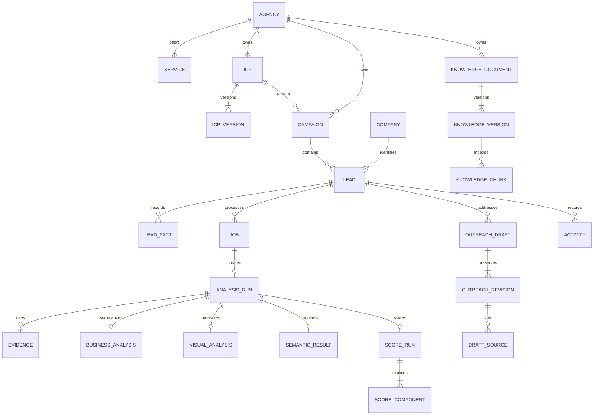

# Shared database design

All tables use SQLAlchemy over SQLite. IDs and FK IDs are server-generated UUID strings stored as TEXT. Times are ISO 8601 UTC TEXT values with `Z`; the interface displays Asia/Karachi. Counts/revisions are INTEGER, measured values are REAL, flags are INTEGER with CHECK in (0,1), vectors are BLOB, and JSON is validated serialized TEXT. Use SQL CHECK constraints where possible and service validation for cross-table rules. JSON columns hold bounded snapshots, not executable content. This is a proposed physical schema for DATA-01–03, not an implemented database.

## Relationships

The diagram shows primary relationships. The table definitions below also specify version, source and job references. Shared company identity has no shared mutable prospect facts: two campaign leads can have different reviewed details without overwriting each other.

## Foundation tables

| Table | Main fields and constraints |
|---|---|
| `schema_versions` | `version` unique, `applied_at`, migration checksum. Reject modified applied migrations. |
| `worker_state` | One row keyed `singleton`; owner token, heartbeat, process-start identity, maintenance_requested flag, worker_paused flag and maintenance reason. Pair with a process-lifetime exclusive lock under data root; do not steal a live lock based only on heartbeat age. Maintenance prevents new mutations/claims; drain already-started transactions before snapshot. |
| `file_cleanup_tasks` | Artifact relative key, reason, state, attempts, last error. Created transactionally when a DB record is deleted; cleanup retries after commit. |
| `activities` | ID, agency FK, nullable campaign/lead FK, action, origin (`operator`, `api`, `worker`, `import`, `n8n`), old/new bounded JSON, timestamp, actor label, unique nullable `event_key`. User deletion cascades lead activities; agency/campaign history remains. Never store secrets or full raw model output here. |

## Configuration and lead tables

| Table | Main fields and constraints |
|---|---|
| `agencies` | ID, `singleton_key=1` UNIQUE and CHECK, required trimmed name, description, optional business contact JSON, revision, timestamps. Exactly one workspace enforced by unique singleton. |
| `services` | Agency FK RESTRICT, name, description, active flag, revision, timestamps. Removing means deactivate. Old drafts contain service snapshots. |
| `icps` | Agency FK RESTRICT, name, archived flag, edit revision, current version ID, timestamps. Current version must belong to this ICP. |
| `icp_versions` | ICP FK RESTRICT, version number UNIQUE per ICP, immutable target text, structured industry/country/region criteria, size min/max, exclusions, desired needs, weights, bands, coverage threshold, score-rule version, visual calibration reference, content hash, timestamp. Size nonnegative and min<=max. Validate nonnegative weights and positive eligible total. |
| `campaigns` | Agency FK RESTRICT, ICP FK RESTRICT, name, description, archived flag, revision, timestamps. ICP must be in the same agency. Existing leads/runs retained on archive. |
| `companies` | ID, normalized domain UNIQUE, creation time. Domain identity only; no automatic name merging. Delete unused identities only after checking no lead references. |
| `leads` | Campaign FK RESTRICT, company FK RESTRICT, required company name, original/normalized URL, current optional industry/country/employee/contact/description fields, notes, pipeline state CHECK, edit revision, analytical input revision, timestamps. UNIQUE `(campaign_id,company_id)`. Nullable employee count CHECK >=0. Current facts are a materialized view of provenance, not the only history. |
| `lead_facts` | Lead FK CASCADE, field name, value JSON, source category (`user_provided`, `source_extracted`, `model_inferred`), verified flag, manual actor or evidence ID, source URL, collection time nullable if unknown, recorded time, revision, supersedes fact ID nullable. Each correction appends. Evidence FK SET NULL on evidence deletion; copy citation metadata to keep meaning. |
| `lead_tags` | Optional Should usability enhancement only: lead FK CASCADE, normalized tag, UNIQUE `(lead_id,tag)`. No core dependency. |
| `reviewer_overrides` | Lead FK CASCADE, kind (`exclusion`, `qualification`, `priority`), optional score-run FK, value, required reason, reviewer label, timestamp, revoked timestamp. Keep separate from calculated values. |

ICP changes append a version and update the current pointer in one transaction. Do not expose editing of an old version. Changing a campaign's ICP does not rewrite runs; it changes currentness. `icps.current_version_id` is assigned after initial insertion in the same transaction to manage the circular reference. Require it before an ICP becomes usable. Do not allow archived ICPs for new campaigns; existing campaigns require an explicit replacement or reactivation before new analysis.

## Processing and evidence tables

| Table | Main fields and constraints |
|---|---|
| `jobs` | Agency FK, nullable lead FK CASCADE, nullable knowledge-version FK added in module 12, kind (`analysis`, `knowledge_index`, `outreach`), status, stage, request hash, immutable input JSON, idempotency key, scope, progress counts, bounded public error, queued/started/finished times, heartbeat, cancel flag, retry-of job FK SET NULL. UNIQUE `(agency_id,scope,idempotency_key)`. Require lead for analysis/outreach and knowledge version for index via service checks. Partial unique index on lead for active analysis (`queued`,`running`); drafts also serialized per lead. |
| `job_stages` | Job FK CASCADE, name, state, attempt count, input hash, output reference JSON, warnings/errors, started/finished times. UNIQUE `(job_id,name)`. Attempt and repair counts bounded. |
| `analysis_runs` | Job FK CASCADE UNIQUE, lead FK CASCADE, ICP-version FK RESTRICT, lead revision, evidence mode, full configuration/model/prompt snapshots, fingerprint, freshness cache/reasons, timestamp. Analysis results immutable after stage completion except review annotations and derived currentness. |
| `evidence` | Run FK CASCADE, kind (`text`,`screenshot`), mode (`live`,`cached`,`uploaded`), original/source/final URL, collection time nullable, imported time, title, cleaned text nullable, original/thumbnail artifact keys nullable, content hash, bytes, dimensions, viewport, extraction settings, warnings, usable flag, review revision and reviewer reason. No absolute path in public serialization. |
| `business_analyses` | Run FK CASCADE UNIQUE, validated bounded JSON, source-mapped claims, hypothesis list, selected text/chunk metadata, runtime manifest, prompt version, raw diagnostic key nullable. Does not overwrite lead corrections. |
| `visual_analyses` | Run FK CASCADE UNIQUE, screenshot evidence FK, config version, metrics JSON, usability, optional experimental score and calibration ID, limitations, optional CNN reference. Missing metrics stored null, not 0. |
| `embeddings` | Agency FK RESTRICT, purpose, model ID/revision, config hash, input hash, dimensions, normalized flag, float32 BLOB, created_at. UNIQUE `(agency_id,purpose,model_revision,config_hash,input_hash)`. No unsafe pickle. References below are RESTRICT while results use a vector. |
| `semantic_results` | Run FK CASCADE UNIQUE, company/ICP embedding FKs, input hashes, raw cosine nullable, normalized value nullable, availability reason, model config. |
| `score_runs` | Run FK CASCADE, lead FK CASCADE, ICP-version FK RESTRICT, version within run, rule version, input fingerprint, score nullable, coverage 0..1, eligible/available weights, numerical band nullable, displayed priority, ineligible flag/reasons, recommended boolean, freshness, timestamp. Recompute creates a new run/job in v1, not an in-place score edit. |
| `score_components` | Score FK CASCADE, component key UNIQUE per score, state (`available`,`missing`,`not_applicable`), raw/value nullable, configured/eligible/available weight, numerator contribution, normalized contribution nullable, evidence/fact citation snapshot, explanation. |

`saved_evidence_uploads` is added in module 07: ID/opaque token, lead FK CASCADE, source type, source URL, collection/import times, controlled text/image keys, hashes, expiry, state (`ready`,`attached`,`expired`) and nullable owning-job FK. Validate and stage the upload first, then store its manifest; uploading does **not** create a job/run. Analysis initiation atomically attaches a ready token to its new job. Poll/replay/restart uses this durable manifest, not process memory. A new retry reuses validated retained manifest/evidence, or requires a fresh upload if unavailable. Never delete attached artifacts as expired staging. A cleanup task removes expired unattached files. Reused evidence retains original collection time and origin evidence ID; do not relabel it live.

## Knowledge and outreach tables

| Table | Main fields and constraints |
|---|---|
| `knowledge_documents` | Agency FK RESTRICT, title, type (`service`,`case_study`,`profile`,`other`), approved flag, fictional-demo flag, archive flag, edit revision, current-version ID, timestamps. |
| `knowledge_versions` | Document FK RESTRICT, version UNIQUE per document, immutable text, content hash, chunk/model configs, indexing state, timestamps. Editing creates a new version. Older versions are immediately ineligible for retrieval. |
| `knowledge_chunks` | Version FK RESTRICT, ordinal UNIQUE per version, start/end offsets, bounded text, embedding FK RESTRICT, index config. Active eligibility derived by joins: active approved document + current version + completed compatible index. No standalone flag can bypass that filter. |
| `outreach_drafts` | Lead FK CASCADE, service FK RESTRICT, selected analysis-run FK RESTRICT, generation job FK, series number UNIQUE per lead, edit revision, current-revision ID, created_at/updated_at. A regenerated draft is a new series, not an approved series overwrite. |
| `outreach_revisions` | Draft FK CASCADE, revision UNIQUE per draft, subject/body, state (`Draft`,`Edited`,`Approved`,`Rejected`), prior revision FK, company/service/knowledge snapshots, model/prompt config, grounded-claim JSON, factual-review acknowledgment, reviewer label, reviewed_at, review reason, freshness warning, created_at. Text of an approved/rejected revision is immutable. A review creates a new revision copying text. |
| `draft_sources` | Revision FK CASCADE, knowledge-chunk FK RESTRICT nullable, evidence FK SET NULL nullable, lead-fact FK SET NULL nullable, similarity nullable, source type, source label/URL and excerpt snapshot, claim IDs. Preserve citation snapshots even if upstream facts are removed. |
| `cnn_features` | Optional: visual-analysis FK CASCADE, weights digest, preprocessing hash, dimensions, vector BLOB and nearest-reference snapshot. Separate from authoritative score. |

Archive knowledge and deactivate services instead of hard-deleting records referenced by drafts. Restore exercises must keep knowledge text, chunks and vectors aligned; storing vectors in SQLite avoids a second mutable vector database. An optional derived NumPy file cache is rebuildable and not the authority.

## Indexes and consistency

Index leads by `(campaign_id,pipeline_state,created_at,id)`, company name, and current score lookup. Index score runs by `(lead_id,created_at)`, jobs by `(status,queued_at)`, activities by `(lead_id,created_at,id)`, knowledge by agency/current version, and facts by `(lead_id,field_name,revision)`. Use a deterministic latest-score query; never join every historic score and multiply lead counts. Snapshot JSON schemas get a version number so future migrations can interpret old records.

Enforce agency consistency in services and test every cross-agency reference even though v1 has only one agency. Check lead/evidence/run identity before attaching a source. Foreign keys catch missing records, while services catch incorrect relationships. For concurrent edits use entity `revision` and `If-Match`; stale writes return `409 EDIT_CONFLICT`. Module migrations add references only after their target tables exist; adding FK constraints to existing SQLite tables requires a tested table-rebuild migration rather than assuming unrestricted ALTER TABLE support.

## Deletion, artifacts and backup

Lead deletion requires `confirm=true` and no active jobs. In one transaction collect owned artifact keys, create cleanup tasks, delete lead-owned drafts/sources, scores, analyses, stages/jobs, facts, overrides, tags and activities, then delete the lead. Ordering avoids RESTRICT references from its own drafts. Never delete services, ICP versions, campaign or agency knowledge. Remove unreferenced lead embeddings after a reference check; keep shared vectors used elsewhere. Other leads cannot cite this lead's evidence by design.

Filesystem deletion cannot be atomic with SQLite. After commit, controlled cleanup retries deletes under `DATA_DIR`; DB deletion is complete even if cleanup is pending. Record failures without returning filesystem paths. Reconcile orphan files on startup and after restore. Verify resolved paths remain within data root, and reject symlink/reparse-point escapes. Retention lasts until explicit deletion, except expired uncommitted uploads/diagnostics under documented policies.

Backups pause intake and drain/stop worker writes, use SQLite's backup API, and copy associated evidence/knowledge/manifest files to a versioned snapshot with hashes. Restore into a separate validated directory first. Check foreign keys, schema version and artifact hashes before replacing the active set. Back up DB, index and files as one set; copying a live `.sqlite3` alone is insufficient with WAL. Module 19 owns the detailed restore test.
