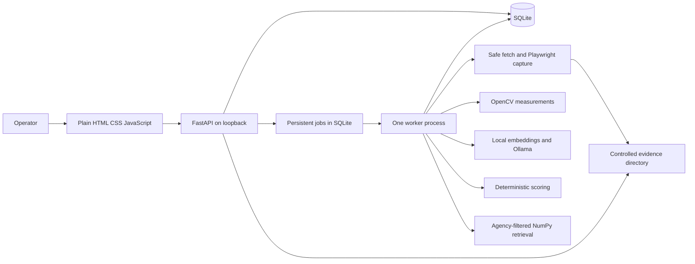

# Shared technical design

## Purpose and agreed boundaries

One operator runs one agency workspace on a Windows laptop. Multiple ICPs and campaigns are allowed. The browser talks to FastAPI on loopback; SQLite stores structured history; a separate local worker does slow work. HTML, CSS and JavaScript provide the interface after the backend workflow passes in Swagger. This follows SRS pages 3–4 and 14–17.

The authoritative lead score comes from Python rules. Models summarize evidence and compare text; they do not decide facts, send messages, or move sales statuses. Missing information stays missing. All downloaded pages, uploaded material and generated text are untrusted data.

## Terms used in these plans

| Term | Simple meaning |
|---|---|
| Database relationship / foreign key (FK) | A stored link to another record, such as a lead's campaign. The database rejects links to records that do not exist. |
| Transaction | A small group of database changes that all succeed together or all roll back. |
| Immutable snapshot | A saved copy that is never rewritten, so an old score can still be explained. |
| Provenance | Where a value came from: a person, a website excerpt or a model hypothesis. |
| Job / stage | A queued piece of work and one named step inside it. |
| Idempotency key | A request label that lets a repeated click/request return the original job instead of starting a duplicate. |
| Stale | The result used an older input; it remains visible but needs recomputation for a current decision. |
| Embedding / cosine | A number vector representing text, and a calculation comparing two vectors. Neither measures buying probability. |
| RAG / chunk | Retrieving relevant saved facts before writing, and a small source-linked piece of a document. |
| Endpoint / schema | An API address for an operation, and the allowed fields/formats for its input or output. |
| Current pointer | The ID of the latest usable version; earlier versions stay in history. |
| Cascade / restrict | Delete a record's owned children automatically, or block deletion when another record still needs it. |

For example, a campaign belongs to the agency and selects an ICP. A lead belongs to that campaign. Its first analysis saves the ICP version and evidence it used. If the operator later changes the ICP, the old score stays readable, but it becomes stale. A new job produces a new score; it does not rewrite the old explanation.

## Architecture and responsibilities



Routes translate HTTP to service calls. Pydantic schemas validate external input and output. Services own business rules. Repositories perform SQLAlchemy queries. ORM models define storage. Worker handlers call the same services without HTTP. Prompt templates only shape language; validation and allowed operations enforce behavior.

Use SQLite with SQLAlchemy, foreign keys enabled on **every connection**, WAL mode, a bounded busy timeout (proposed 5 seconds), and short transactions. Use a lightweight numbered migration runner with a schema version table, rather than an enterprise migration stack. One API process and one worker process are supported. A second worker must fail to acquire the singleton worker lock. Do not start a worker in every FastAPI reload process.

The worker persists jobs in SQLite, claims one atomically, releases the transaction, runs the stage, and commits its result in a new short transaction. API requests never wait for inference. A shared worker handles analysis, knowledge indexing and draft generation serially. The queue therefore also serializes generation. Browser capture concurrency is one. Failed stages do not erase successful earlier stages.

## Model and package decisions

**Proposed benchmark candidates**, not installed or measured selections:

| Role | Candidate | Decision before implementation |
|---|---|---|
| Language generation | Ollama `qwen2.5:1.5b`, Q4_K_M | Start at 4,096 context tokens, 768 output tokens, temperature 0; benchmark schema validity and factual grounding. Fall back to a smaller candidate only after recording the tradeoff. |
| Text embedding | `sentence-transformers/all-MiniLM-L6-v2` | CPU, normalized float32, 384 dimensions; pin downloaded revision and enforce tokenizer limits. |
| CNN extension | TorchVision `ResNet18_Weights.IMAGENET1K_V1` | Inference-only, recorded weight transform; load separately from generation when memory is tight. |

The [Ollama model page](https://ollama.com/library/qwen2.5:1.5b) lists the proposed LLM at approximately 986 MB and Apache 2.0. The [embedding model card](https://huggingface.co/sentence-transformers/all-MiniLM-L6-v2) records Apache 2.0 and 384-dimensional embeddings. [TorchVision's ResNet18 documentation](https://docs.pytorch.org/vision/stable/models/generated/torchvision.models.resnet18.html) defines the weight identifier and associated transforms. These sources were checked on 7 October 2026. Record exact downloaded digests and actual licence files; generic framework licensing does not settle rights for reference images or datasets. These specifications do not prove laptop performance.

Use a compatible supported Python minor version after checking Windows wheels for Torch, OpenCV, Playwright and SQLAlchemy. Phase 1 uses and tests the installed Python 3.14.8; this is **not** a decision that every planned AI dependency supports it. Consider Python 3.11 or 3.12 if later compatibility requires a change. Pin only versions actually installed and tested together. Keep core and optional ML/CNN/n8n dependencies separate. The user authorized phase 1 construction after this design was written; foundation dependencies are installed, and model installation remains deferred.

Maintain `model-manifest.json` with role, ID, revision/digest, licence, download source, bytes, context/dimensions, preprocessing and benchmark date. Combined initial model-download target is at most 5 GB. Track browser and Python dependency downloads separately; avoid implying the model budget covers all installation data.

## Future folder structure

```text
LeadVision/
  backend/
    app/
      main.py                       # API creation and static interface mounting
      core/                         # config, errors, time, hashes and safety
      db/                           # sessions, migrations and repositories
      models/                       # ORM tables by domain
      schemas/                      # request, response and model-output validation
      api/                          # thin route handlers
      services/                     # business rules
      integrations/                 # model, browser and HTTP clients (planned)
      worker/                       # persistent worker (planned)
      prompts/                      # versioned model prompts (planned)
    tests/
      unit/
      integration/
      fixtures/                     # small lawful fixtures (planned)
    pytest.ini
    .env.example
    requirements.in
    requirements.lock.txt
    requirements-optional.in        # planned optional dependencies
  frontend/                         # planned HTML, CSS and JavaScript interface
    index.html
    css/app.css
    js/
  scripts/                          # start/test helpers; future backup commands
  experiments/                      # planned CNN/ML artifacts
  workflows/                        # planned n8n exports
  docs/
    implementation/
    evaluation/                     # planned evaluation results
  data/                             # ignored runtime data
    leadvision.sqlite3
    evidence/
    knowledge/
    diagnostics/
    trash/
  .venv/                            # ignored local Python environment
  .cache/                           # ignored tooling cache
  .gitignore
  README.md
```

Backend code and tests live under backend/, frontend files under frontend/, documentation under docs/, and launch/maintenance commands under scripts/. Configuration loads backend/.env; relative runtime paths stay anchored to the project root. The shared project virtual environment remains at .venv/. Each module plan names the specific files it owns. Split a file only when responsibilities need it; the diagram is a convention, not a demand to create empty boilerplate. Keep model caches outside the repository. Configure `DATA_DIR`, API/Ollama hosts, timeouts, model IDs and limits outside code. Store internal relative artifact keys, never client-controlled absolute paths.

## Complete processing workflow

1. Create agency and active services; create ICP and immutable configuration version; create campaign selecting that ICP. Each campaign uses the selected ICP's current version for **new** runs.
2. Add a lead or import CSV. Preserve original website and user-field provenance. Normalize a company domain for uniqueness within the campaign. Start pipeline state `New`.
3. Upload saved evidence if needed. Select `live`, `cached` or `uploaded` mode explicitly. The API creates an analysis job with an idempotency key and immutable input snapshot, then returns `202` without running stages in the request.
4. Worker verifies campaign activity and captured input revisions before claiming. Collect bounded website text and homepage screenshot, or attach validated saved evidence. Store evidence and hashes before models run.
5. Preprocess text and request validated business analysis. In parallel conceptually, image measurements depend only on evidence; the single worker executes them sequentially for simplicity. Missing screenshot skips CV; missing usable text skips semantic processing. Preserve warnings independently.
6. Embed the reviewed description, else a supported generated description, else a bounded cleaned-text excerpt. Record which representation was chosen. Compare with ICP vector using the same model/configuration. No text means missing similarity.
7. Evaluate structured criteria and hard exclusions, compute score and coverage, record contributions and currentness. Commit completed/partial/failed job status. A model failure can still leave a usable structured score and collected evidence.
8. Operator reviews evidence and corrects fields. Corrections append provenance and mark dependent outputs stale; explicitly request recomputation. Do not quietly replace prior results.
9. Add and index approved agency knowledge. Request a draft with selected active service and a current reviewed run. Retrieve up to three eligible chunks; generate a source-mapped draft or an explicitly service-only draft if retrieval is empty.
10. Operator edits and approves or rejects. Store immutable text revisions, reviewer and timestamp. Copy approved text for manual use. No sending occurs.
11. Operator changes pipeline state explicitly. Record event and display campaign-filtered counts.

## Processing, stage and freshness states

Public job states: `queued`, `running`, `completed`, `partial`, `failed`, `cancelled`. Stages: `pending`, `running`, `succeeded`, `warning`, `failed`, `skipped`. An interrupted process maps to `failed` with `error.code=JOB_INTERRUPTED` rather than adding a conflicting public `Interrupted` state. Save interruption as the failure reason.

Analysis stages: `validate_inputs`, `acquire_text`, `acquire_image`, `preprocess_text`, `business_analysis`, `visual_metrics`, `semantic_match`, `score`, `finalize`. All required outputs present means completed, including informational warnings such as recorded truncation. Any usable stage output plus a required missing/failed stage is partial. No usable evidence or component is failed. An acquisition result is usable even when scoring is unavailable. Optional CNN absence does not downgrade a core analysis. Every result includes stage outcomes so the terminal label is understandable.

Cancellation is cooperative between stages and aborts network/model work when the client supports it. Previously committed outputs remain inspectable. Queued jobs can resume after restart only if captured revisions still match; otherwise fail `INPUT_CHANGED` and invite a fresh request. A running job fails on restart and a user retry creates a **new run**; v1 does not resume selected old stages. Reuse validated hash-matching caches when safe, but record the reused source.

One automatic transient retry per stage is permitted. The NLP stage's one schema repair counts against its stage recovery budget: do not combine a transport retry and additional repairs into unbounded attempts. A user retry is a separate recorded job with a new key. Apply the same maximum to draft and index stages.

Inputs can change while a run is active. Its immutable snapshot still explains the result, but finalization marks it stale if current revisions differ. Block lead deletion while a job is active; allow cancellation first. An archived campaign blocks initiation and fails queued-but-not-started analysis; a started run may finish historically, with its eligibility currentness rechecked.

## Freshness and provenance rules

Use hashes plus version references, not only a `stale` boolean. Each run holds lead input revision, evidence IDs/hashes, ICP version, rule/threshold version, model manifests and prompt version. Mutable records have a separate edit `revision` for conflict detection. Lead notes/pipeline edits increment edit revision but not analytical input revision. Each stage compares its actual dependency hashes; one changed field must not invalidate unrelated cached outputs. `stale_reasons` is derived against current pointers and can be cached for lists. Old runs never have their inputs rewritten.

| Changed input | Outputs affected |
|---|---|
| Company description or corrected facts | Business interpretation as relevant, semantic and score; dependent draft grounding |
| Website identity or selected evidence | Evidence-based business analysis, CV, semantic, score, drafts |
| Industry, country or employee count | Structured score and exclusions; draft if it used the fact |
| Notes only | No analytical invalidation unless explicitly selected as analysis input |
| ICP criteria, weights or thresholds | Scores; semantic only if target text changed; current recommendation suppressed until recomputed |
| Screenshot usable flag or visual config | CV and CV-enabled score; any draft observation using that image |
| Embedding model or preprocessing | Affected vectors, semantic results and knowledge index; derived score and draft retrieval |
| Knowledge edit/archive or service edit | Retrieval/grounding of related drafts; historical approved text retained and warning shown |
| Pipeline status | Counts and activities; no model recomputation |

User corrections outrank source-extracted values; model-inferred hypotheses never become hard facts automatically. Each asserted field stores category, value, manual origin or evidence reference, collection time and verification state. Use `null` for unknown size, not zero. Industry candidates need reviewer confirmation before industry score is available. Country and employee count can be scored only from user-provided values or explicit verified evidence.

## Identity and sales decisions

Normalize host to lowercase IDNA, remove one leading `www.`, reject credentials and malformed hosts, and omit default ports from normalized URLs. Domain identity ignores scheme, path, query, fragment and port. Preserve non-default ports in fetch URLs; they do not create new companies. Do not collapse arbitrary subdomains or guess a registrable parent. `shop.example.com` and `example.com` remain distinct until an explicit future merge design. Across campaigns, one shared company identity can have separate leads, facts and analysis. Changing a lead domain reassigns its company FK rather than mutating a company shared by another campaign.

Default sales transitions are specified in module 14. Qualification is a manual decision: a recommendation never changes pipeline status. A hard exclusion blocks ordinary qualification until a reasoned exclusion override is recorded. Low coverage or stale results produce Needs review and can only be manually qualified through a recorded reviewer decision acknowledging the warning.

## Proposed bounds beyond the SRS

Use MB as decimal bytes consistently (1 MB = 1,000,000 bytes). CSV: 5 MB and 100 data rows. Knowledge: 1 MB per UTF-8 TXT. Saved images: 10 MB and 20,000,000 decoded pixels. Website page: 2 MB decoded response body, at most homepage plus two same-domain pages, 30 seconds per navigation/fetch, one retry, at most five redirects. Validate streaming compressed and decoded limits. Browser requests need additional aggregate resource bounds, detailed in module 07.

Proposed new defaults to review: cleaned text 30,000 characters/page; uploaded saved text 1 MB; summary 1,000 characters; lists 10 entries; draft subject 200 characters and body 2,000 characters; generation deadline 120 seconds; job deadline 300 seconds; page size 25, maximum 100. Enforce token budgets separately from character limits. A 300-second deadline is a resource ceiling, not a claim that the five-minute target has been achieved.

## Remaining decisions and amendments

- Confirm model candidates through schema-validity, timing and memory tests; record licences/digests. Do not freeze untested package versions.
- Windows and PowerShell are known from session context. Available disk capacity could not be established through the restricted environment; check it before any future downloads.
- Confirm whether the instructor upgrades CNN, n8n or ML to Must. Until then, SRS priorities apply.
- Select lawful cached evidence, agency content and CNN references. Collect independent fit labels before score inspection.
- Review proposed score taxonomy, region mapping and industry matching, browser network-isolation choice, draft source mapping and API limits before coding their modules.
- Git initialization and first GitHub push are future delivery steps. Confirm repository visibility before pushing as the SRS requests; planning does not publish anything.

Any amendment records affected requirement IDs, revised acceptance evidence, reason and deadline impact. Keep a decision log with statuses `proposed`, `benchmarked`, `accepted` or `deferred`.
